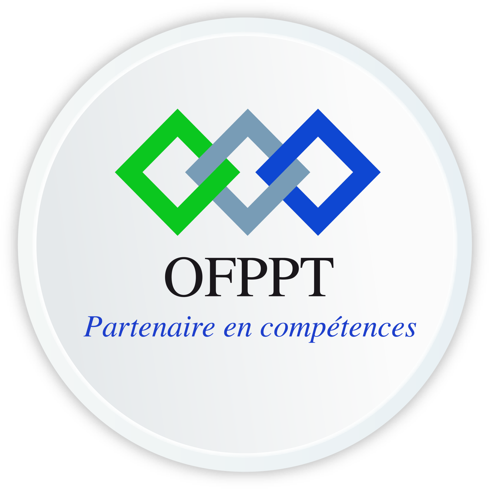
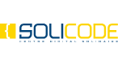

<!-- markdownlint-disable MD025 -->
# Présentation short overview of my work in web development
<!-- { width=200px }
{ width=200px } -->

- **Apprenant** : Badreddine Hammam
- **Encadrant** : ESSARRAJ Fouad
- **Établissement** : Solicode Tanger
- **Domaine** : Développement Web
- **Date** : 2026-11-23
---

## A short overview of my work in web development

Labs · Project Blog · Fil Rouge · Project Technique · Technology Watch

---

## My learning path

```text
LEARN A CONCEPT  →  PRACTISE IT  →  BUILD A PROJECT  →  REVIEW THE RESULT
```

Each activity helps me understand web development step by step.

---

## 1. Labs

### What is a lab?

A **lab** is a practical exercise. It helps me use web development concepts and test code in a small, guided task.

**Past**  I gave a presentation about Scrum and how I used it in my project. I received *partial validation* from my teacher.

**Today**  I am not working on a lab.

**Next**  I will create a new lab.

---

## 2. Project Blog

### What is the Project Blog?

The **Project Blog** is an organized web development project. It brings lessons, documentation, and project work together in one place.

```text
.agent · docs · issues · presentation · rapport
sprints · tutoriels · .gitignore · README.md
```

---

## Project Blog · My progress

### Past Work

- I organized the project structure using what I learned in class.
- I prepared a report about *Blog des Lauréats* and created a README file.
- I studied AI engineering.

**Now**  I will continue working through the chapters about *Blog des Lauréats*.

---

## 3. Project Fil Rouge

### What is a Fil Rouge project?

A **Fil Rouge project** is a larger project that grows step by step. I add new features and technologies as I learn them. This project uses **CRUD** actions:

Create → Read → Update → Delete

---

## Fil Rouge · My progress

### Past

- I gave a presentation and wrote a report about a professional network.
- I created project code for the professional network.

**Now**  The Fil Rouge project is complete. I am working on another assignment.

---

## 4. Project Technique

### What is a Project Technique?

A **Project Technique** is a small prototype. It focuses on **Create** and **Read** so I can practise new technologies and check what I have learned.

```text
CREATE information  →  READ and display information
```

---

## Project Technique · My progress

**Past**  I prepared my Project Technique using the new ideas I learned in my last PHP lab.

**Focus**  Practise the new PHP concepts in a simple working prototype.

---

## 5. Technology Watch

### What is a technology watch?

A **technology watch** means following news and changes in technology. I look at new tools, ideas, and trends, then consider how they may be useful.

**Past**  I have not started my technology watch yet. I have selected a topic.

**Next**  I will begin researching my topic and collect useful information.

---

## What comes next?

```text
Create a new lab
       ↓
Continue the Blog chapters
       ↓
Start the selected technology watch
```

### Keep learning

Learn · Practise · Build · Improve.
